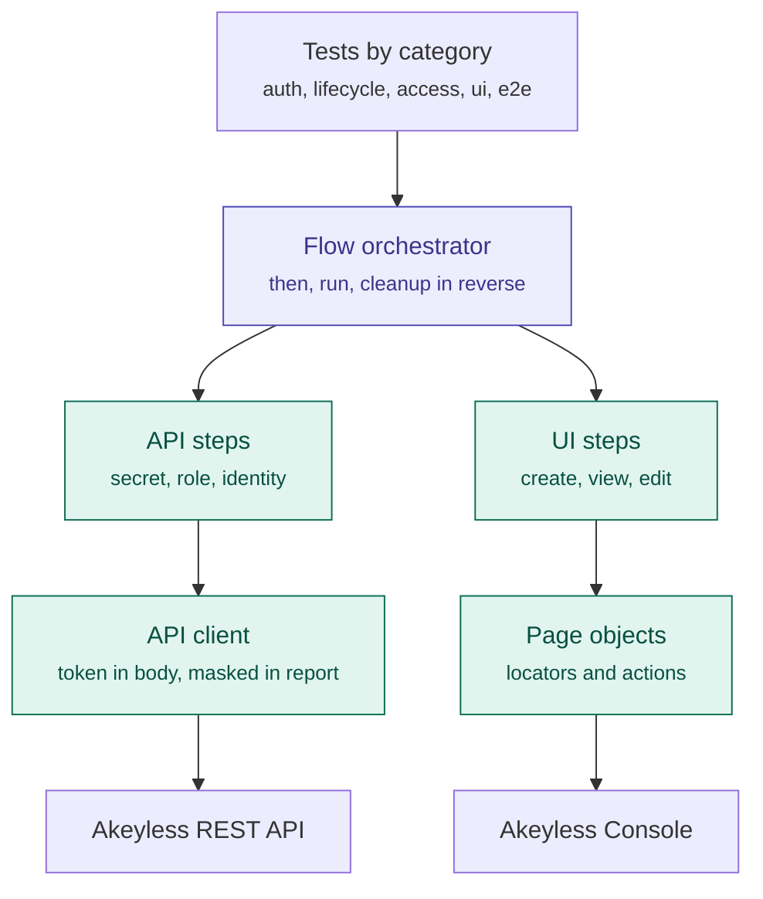
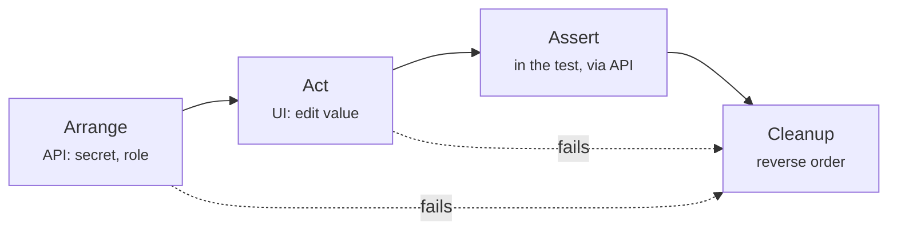

# 2. Test strategy

System: Akeyless, feature Static Secrets + access roles (see [system review](01-system-review.md)).

## Scope

**In scope:**
- Static secret lifecycle via REST API: create, read, update (versions), roll back, list, delete
- Access control on static secrets: role rules by path and capability (read / list / update /
  delete / deny)
- API contracts and error handling (auth, missing items, invalid input)
- Console (UI): create, view (masked value) and edit a secret - only what a user sees
- One E2E journey per layer boundary: API setup -> UI action -> API verification

**Out of scope (and why):**
- Dynamic / rotated secrets, encryption keys, certificates, PKI - separate features, own risks
- Gateway, Kubernetes injection, CI plugins - need infrastructure; the API is the same contract
- SSO / SAML / OIDC auth methods - external identity provider; access key covers the auth logic
- Secure sharing with external users, Secure Remote Access - separate flows
- Performance / load - shared SaaS, not ours to load; noted as future work
- Cryptography itself (DFC) - not testable as a black box; trust vendor audits

## Risk analysis

Priority = impact x likelihood. A secrets manager has two worst failures: **a secret leaks to
someone who should not see it**, and **a secret is lost or wrong** (apps go down).

| Area                                      | Impact | Likelihood | Priority | Why                                                                      |
|-------------------------------------------|--------|------------|----------|--------------------------------------------------------------------------|
| Access control: read without permission   | H      | M          | **P1**   | Leak = security incident; rule logic (paths, wildcards, deny) is complex |
| Auth: invalid / missing token accepted    | H      | L          | **P1**   | Total bypass; cheap to test                                              |
| Create -> read returns the exact value    | H      | L          | **P1**   | Core promise; wrong value breaks every consumer                          |
| Update keeps the previous version         | H      | M          | **P1**   | Rollback is the safety net after a bad change                            |
| Delete really removes access              | H      | M          | **P1**   | Revoked credential still readable = leak                                 |
| Value never returned by list / describe   | H      | L          | P2       | Metadata calls are widely permitted (`list`)                             |
| Input validation (names, formats, size)   | M      | M          | P2       | Bad data stored or confusing errors                                      |
| Version limits, rollback, multi-name read | M      | M          | P2       | Edge of versioning logic                                                 |
| Delete protection                         | M      | L          | P2       | Guard against accidental delete                                          |
| Console: create / masked view / edit      | M      | L          | P1/P2    | Main UI path; masked value is a security UX rule                         |
| Token expiry, cache staleness             | M      | L          | P3       | Needs long waits / Gateway; manual                                       |

- **P1** - smoke: automated, runs on every commit
- **P2** - regression: automated if time allows
- **P3** - documented, manual / future

## Test levels - what goes where

| Level | What it covers                                                            | Why at this level                        |
|-------|---------------------------------------------------------------------------|------------------------------------------|
| API   | Lifecycle, versions, access rules (decision table), validation, contracts | The product is API-first; fast, precise  |
| UI    | Create form, masked value, validation messages, edit                      | Only what the Console user sees          |
| E2E   | Arrange via API -> act in Console -> verify via API                       | Proves UI and API agree on the same data |

Access control is tested at API level only: the Console calls the same API, so the rule logic is
tested once, where failures are precise. The UI gets one check that a read-only user cannot edit.

## Framework design - chain of steps

Tests are built as a **chain of reusable steps** run by a small **flow orchestrator**. The
orchestrator is generic (no Akeyless code); only the steps, the API client and the page objects
know the system. Variations are data (`parametrize`), so one chain covers many combinations, and
each test group (category marker) varies one thing.

### The pipeline under test - secret access

Every request to Akeyless goes through the same stages; each stage has its own variations:

```
identity (auth method) -> token -> role rules -> item (type, format, version) -> delivery channel
```

| Stage      | Variations                                                      | Test group (folder) | In this demo                 |
|------------|-----------------------------------------------------------------|---------------------|------------------------------|
| Identity   | access key, API key, JWT/OIDC, Kubernetes, AWS IAM, certificate | `tests/api/auth/`   | access key / API key         |
| Role rules | read, list, update, delete, deny; folder, sibling, prefix       | `tests/api/access/` | decision table (8 rows)      |
| Item       | text, multiline, JSON, unicode; versions                        | `tests/api/items/`  | 5 values + versions          |
| Delivery   | REST, CLI, SDK, Gateway (cache), K8s injector, CI plugins       | -                   | REST only (rest needs infra) |

Each group varies **one** stage and keeps the others at the default (one-at-a-time). Varying everything against
everything would be ~1,500 combinations; for a real project a small pairwise set would cover the interactions.

Test groups are **folders**: `tests/<layer>/<category>/`. A hook in `tests/conftest.py` turns the folder into a
marker and an Allure label (`api` -> `access`), so tests carry no category markers and a new category is just a
new folder. Run one group: `pytest tests/api/access` or `pytest -m access`. In code, one pipeline row is:

```python
flow.then(create_secret(folder="app")).then(limited_identity([(["read"], "{root}/app/*")])).run()
response = flow.ctx["identity"].get_secret_value([flow.ctx["secret"].name])  # act
assert response.ok  # assert in the test
```

### Layers



Purple = generic, reusable for any system. Green = Akeyless-specific.

### One chain run (E2E)



Rules:

- The flow **arranges and acts**; the **test asserts** - a reader sees what is checked in the test.
- Every step that creates something registers its own cleanup; cleanup runs in reverse order,
  even when a step or an assert fails.
- API steps do setup and verification; a UI step is used only for what the test is about.

### Implementation - kept simple for this demo

The orchestrator is a thin `Flow` class (~50 lines) on standard pieces, not a custom engine:

- `contextlib.ExitStack` - cleanup stack, runs in reverse order, continues if one cleanup fails
- `allure.step` - each step is a named step in the report
- a pytest fixture - creates the flow and closes it in teardown
- `pytest.mark.parametrize` - variations with readable `ids`

**For a real project** I would consider:

- **ScreenPy** (Screenplay pattern: actors, tasks, questions) - when many teams share steps
- **pytest-cases** - richer combinations of fixtures and parameters
- **pytest-bdd** - when product owners read or write the scenarios (Gherkin)
- **tenacity** - polling for async processing (queues, background jobs)
- Pairwise generation (e.g. `allpairspy`) - when variation tables grow too large to list by hand

## Test design techniques

- **Decision table** - access rules: capability x path match x deny -> allowed / denied
  (TC-API-016..019)
- **State transitions** - secret lifecycle: none -> v1 -> v2 -> rolled back -> deleted
  (TC-API-003, 005, 006, 015)
- **Equivalence partitioning / boundary values** - names (empty, path, unicode, max length),
  values (empty, multiline, JSON valid/invalid, max size), `version` (-1, -20, -21)
- **Contract tests** - pydantic models for `/auth`, `/get-secret-value`, `/list-items`,
  `/delete-item` responses and the `{"error"}` shape
- **Negative / error handling** - no token, bad token, missing item, duplicate name

## Test data

- Every run works under its own folder: `/qa-autotest/<run-id>/` and every test under
  `<test-name>-<uuid>` -> independent and parallel-safe (`pytest -n auto`).
- Setup through the API with an **admin** access key. For access tests, each test creates its own
  role + rule + **limited** access-key auth method, and authenticates as that identity.
- Values are random (`secrets.token_urlsafe`), never real credentials.
- Cleanup: `delete-item` (`version: -1`) in fixture teardown; a session-end sweeper deletes
  anything left under `/qa-autotest/<run-id>/` (and items older than 1 day from crashed runs).

## Environment & execution

- A dedicated Akeyless test account (free tier), never a real one.
- Config via env vars: `API_URL=https://api.akeyless.io`, `BASE_URL=https://console.akeyless.io`,
  `AKEYLESS_ACCESS_ID` / `AKEYLESS_ACCESS_KEY` as GitHub Actions secrets - no secrets in the repo.
- Local: `pytest`; CI: GitHub Actions on push, P1 on every commit, Allure report on GitHub Pages.
- Secret values are masked in Allure attachments (the client replaces `value` / `token` fields).

## Risks to the testing itself

| Risk                                        | Mitigation                                                  |
|---------------------------------------------|-------------------------------------------------------------|
| Shared SaaS account, leftovers between runs | Per-run folder + sweeper                                    |
| API rate limits on free tier                | Limited parallel workers; one token per worker session      |
| Error codes undocumented                    | Assert error shape first, pin status codes after exploring  |
| Console UI changes (SaaS, not versioned)    | Few UI tests, role/label locators, API for setup and checks |
| Leaking test tokens into the report         | Mask `token`, `access-key`, `value` in logged bodies        |
